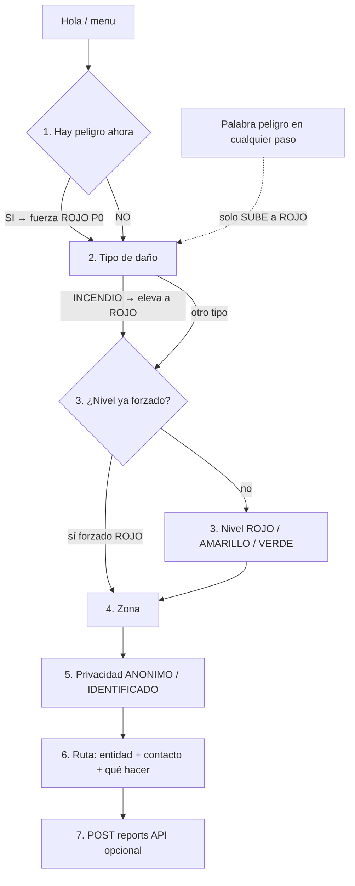

# Árbol de decisión — Manglar Alerta

**Estado:** completo y alineado con el código  
**Fuente viva:** `apps/whatsapp-bot/data.js` (`MENSAJES`, `REGLAS`) + `engine.js`  
**Artefacto JSON:** [arbol-decision.json](./arbol-decision.json)

## 1. Orden del triage

```text
hola / menu
  → 1. Peligro ahora?     (SI | NO)
  → 2. Tipo               (TALA | INCENDIO | RESIDUOS | FAUNA | INVASION)
  → 3. Nivel de alerta    (ROJO | AMARILLO | VERDE)   ← se omite si ya es rojo forzado
  → 4. Zona               (BQ | MUN | COSTA)
  → 5. Privacidad         (ANONIMO | IDENTIFICADO)
  → 6. Ruta               entidad + contacto + acción + evidencia
  → 7. (opcional) POST /api/v1/reports  → tracking GDM-…
```

## 2. Diagrama



## 3. Nodos (preguntas y opciones)

| # | Paso | IDs | Pregunta (copy vivo) |
|---|------|-----|----------------------|
| 1 | `peligro` | `SI`, `NO` | ¿Hay peligro ahora mismo? |
| 2 | `tipo` | `TALA`, `INCENDIO`, `RESIDUOS`, `FAUNA`, `INVASION` | ¿Qué estás viendo? |
| 3 | `nivel` | `ROJO`, `AMARILLO`, `VERDE` | Nivel de alerta |
| 4 | `zona` | `BQ`, `MUN`, `COSTA` | ¿En dónde está pasando? |
| 5 | `privacidad` | `ANONIMO`, `IDENTIFICADO` | ¿Cómo quieres reportar? |

Labels exactos: `MENSAJES` en `data.js`.

## 4. Reglas que alteran el camino

| Regla | Efecto |
|-------|--------|
| `peligro = SI` | Fija `ROJO` (P0) y **salta** el paso nivel |
| Tipo `INCENDIO` | Eleva a `ROJO` aunque el usuario elija otro nivel más bajo después vía palabras clave; al elegir tipo incendio sin peligro previo, el motor fuerza rojo y puede saltar nivel |
| `PALABRAS_PELIGRO` | En cualquier mensaje: **solo suben** a rojo, nunca bajan |
| `raiseNivel` | Compara VERDE < AMARILLO < ROJO; conserva el máximo |

## 5. Clasificación de alertas

| Nivel | Prioridad | Criterio ciudadano | Uso |
|-------|-----------|--------------------|-----|
| `ROJO` | **P0** | Está pasando YA / peligro | 123 / 119 primero |
| `AMARILLO` | **P1** | Ya pasó o se repite | Denuncia con evidencia |
| `VERDE` | **P2** | Limpieza, poda, prevención | Trámite en horario hábil |

Metadatos de tono/evidencia: `NIVEL_META` en `data.js`.

## 6. Matriz de ruta (tipo × nivel × zona)

Dimensiones: **5 × 3 × 3 = 45** celdas. Todas definidas en `REGLAS` (validado: sin huecos).

| Tipo | Qué cubre |
|------|-----------|
| `TALA` | Corte / afectación de árboles |
| `INCENDIO` | Fuego, humo, quemas |
| `RESIDUOS` | Basura, escombros, vertimientos |
| `FAUNA` | Caza, maltrato, avistamiento, tráfico |
| `INVASION` | Ocupación / relleno de terreno o manglar |

| Zona | Alcance |
|------|---------|
| `BQ` | Barranquilla |
| `MUN` | Otro municipio del Atlántico |
| `COSTA` | Playa, manglar o zona costera |

Cada celda tiene: `entidad`, `contacto`, `accion`.

## 7. Privacidad

| Modo | Comportamiento |
|------|----------------|
| `ANONIMO` | Orientación sin pedir nombre; API con `reporterHandle` hasheado opcional |
| `IDENTIFICADO` | Misma orientación + énfasis en seguimiento (`trackingCode` / secreto) |

## 8. Reinicios y atajos

- `hola`, `menu`, `reiniciar`, `reportar`, … → vuelven a peligro
- Tras `DONE`, cualquier mensaje de reinicio empieza de nuevo
- Fallback siempre visible: 123 Policía / 119 Bomberos

## 9. Mapa código ↔ docs

| Concepto | Archivo |
|----------|---------|
| Preguntas / opciones | `data.js` → `MENSAJES` |
| Matriz 45 rutas | `data.js` → `REGLAS` |
| Prioridades / tonos | `data.js` → `NIVEL_META` |
| Máquina de estados | `engine.js` → `STEPS` + `handleIncoming` |
| WhatsApp Twilio | `bot/twilio-server.js` |
| Demo web | `app.js` + `index.html` |
| API reportes | [reports-mapping.md](./reports-mapping.md) |
| Fuentes institucionales | [referencias.md](./referencias.md) |
