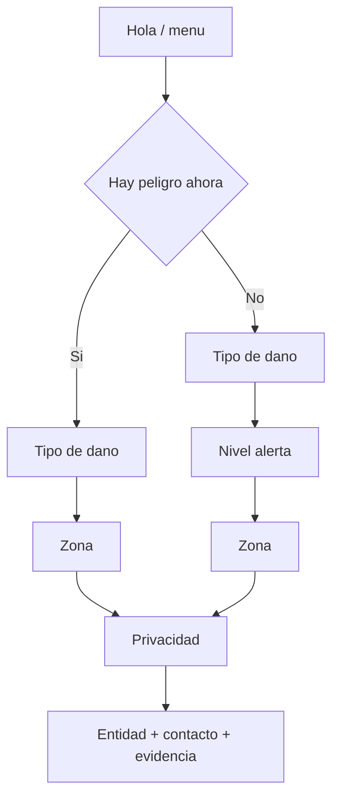

# Árbol de decisión — Manglar Alerta / WhatsApp

## Flujo

## Pasos

1. **Peligro ahora** — si sí, fuerza alerta roja (P0).
2. **Tipo** — tala, incendio, residuos, fauna, invasión. Incendio también eleva a rojo.
3. **Nivel** — rojo / amarillo / verde (estilo gestión del riesgo). Se omite si ya es rojo forzado.
4. **Zona** — Barranquilla / otro municipio Atlántico / costa-manglar.
5. **Privacidad** — anónimo o con datos para seguimiento (estilo denuncia ANLA).
6. **Ruta** — entidad, contacto, qué hacer, evidencia útil.

## Regla de seguridad

Las señales de peligro **solo suben** la urgencia a rojo; nunca la bajan.

## Prioridades

| Nivel | Prioridad | Uso |
|-------|-----------|-----|
| Rojo | P0 | Evento en curso / peligro — 123 / 119 primero |
| Amarillo | P1 | Ya pasó o se repite — denuncia con evidencia |
| Verde | P2 | Limpieza, poda, prevención — trámite hábil |

## Referencias

- Niveles de alerta / gestión del riesgo (UNGRD / SNIGRD)
- Denuncia ambiental ANLA (permite anónimo; pide hechos, lugar, evidencia)
- Ley 1333 de 2009 — medidas preventivas ante riesgo o daño inminente
- Canales EPA Barranquilla Verde (ext. 107 / ventanilla / VITAL)
- VITAL — ventanilla de quejas y denuncias ambientales (MinAmbiente)

Implementación: `apps/whatsapp-bot/data.js` + `engine.js`.
